# OpenNotch

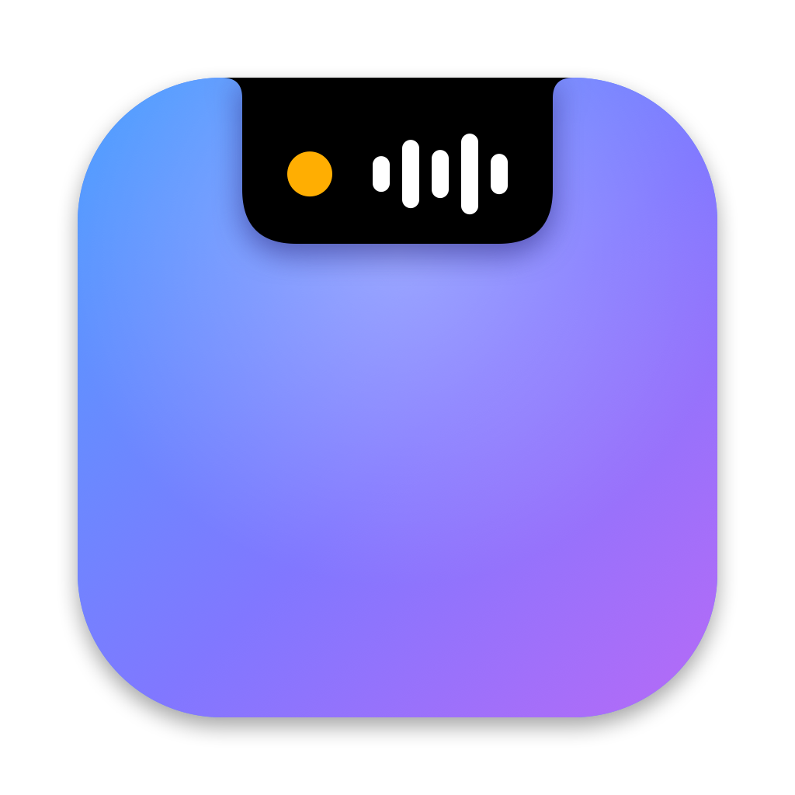

Um app gratuito para macOS que transforma o notch do MacBook em um painel útil: música, agentes de IA, apps abertos, captura de tela, anotações e mais. Sem anúncios e sem recursos bloqueados.

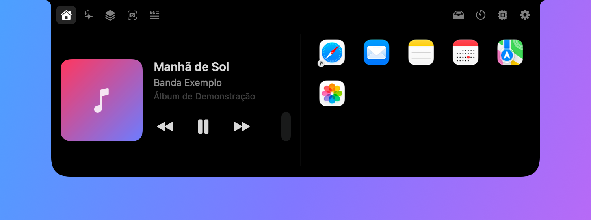

Passe o mouse sobre o notch (ou clique nele) para abrir o painel. Com ele fechado, pequenos indicadores aparecem ao lado do notch: a capa da música, o tempo do timer, quantos agentes de IA estão trabalhando, o cronômetro de uma gravação, o volume e o brilho.

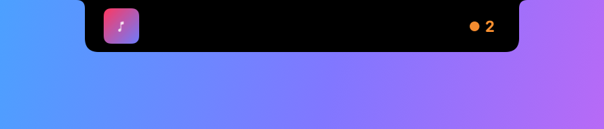

Somente macOS 14 ou mais recente. Em telas sem notch (Macs antigos e monitores externos), o painel fica no centro da barra de menus.

Disponível em português e inglês.

## Baixar

Pegue o **OpenNotch.zip** da [versão mais recente](https://github.com/Nicollasarcanjo/OpenNotch/releases/latest), descompacte e arraste o app para a pasta Aplicativos. Funciona em Macs com Apple Silicon e Intel.

Como o app ainda não é notarizado pela Apple, o macOS bloqueia a primeira abertura. Para liberar, abra **Ajustes do Sistema › Privacidade e Segurança**, role até o aviso sobre o OpenNotch e clique em **Abrir Mesmo Assim**. Pelo Terminal:

```bash
xattr -dr com.apple.quarantine /Applications/OpenNotch.app
```

## Funcionalidades

### Tela inicial personalizável

A primeira aba é uma fileira de blocos que você escolhe e ordena em Configurações › Tela inicial:

| Bloco | O que mostra |
|---|---|
| Música | Faixa, artista, capa e controles |
| Calendário | Data e próximos eventos de hoje |
| Atalhos de apps | Ícones dos apps que você adicionou; arraste um app do Finder até o notch para criar o atalho |
| GIF | Um GIF animado, com cantos arredondados |
| Sequência de imagens | Imagens que trocam sozinhas, no intervalo que você definir |
| Relógio | Hora e data |
| Sistema (resumo) | Anéis de CPU, RAM e bateria |
| Timer (resumo) | Tempo atual e botão de iniciar/pausar |

### Música


- Spotify e Apple Music: título, artista, álbum, capa e botões de voltar, tocar/pausar e avançar.
- Música do navegador (YouTube, YouTube Music, Spotify Web, SoundCloud, Deezer, Tidal, Amazon Music, Apple Music web) por meio de uma extensão para Brave, Chrome e Edge. O passo a passo e o download ficam em Configurações › Extensão do navegador.
- Com o notch fechado, a capa e barrinhas animadas aparecem ao lado dele.

### Agentes de IA

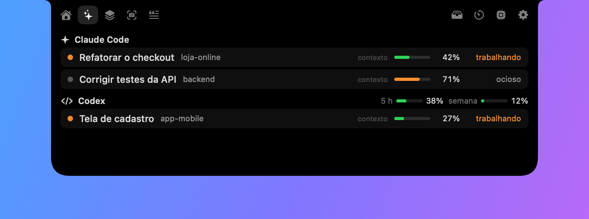

Mostra as sessões de ferramentas de IA abertas no Mac, com o projeto de cada uma e o estado (trabalhando ou ocioso). Quando uma tarefa termina, o notch abre por alguns segundos avisando, com som opcional.

| Ferramenta | O que mostra |
|---|---|
| Claude Code | Sessões abertas, projeto e uso da janela de contexto |
| Codex | Sessões recentes, projeto, uso de contexto e uso do limite do plano (5 h e semanal) |
| Antigravity | Se há um agente trabalhando (detecção aproximada) |
| Outras | Você cadastra pelo nome do processo; mostra a pasta em que roda e o uso de CPU |

Tudo é lido dos arquivos que essas ferramentas já gravam em disco. O OpenNotch não acessa contas, senhas nem a internet para isso.

### Apps abertos

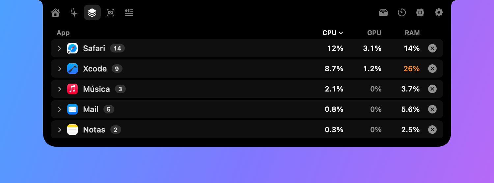

Um gerenciador de tarefas no notch:

- Lista os apps abertos com CPU, GPU e memória, em porcentagem.
- Agrupa todos os processos de um app (auxiliares, abas, outras instâncias) dentro do app principal; clique para expandir.
- Fecha o app inteiro com um clique; "Forçar encerramento" fica no clique com dois dedos.
- Na lista expandida dá para encerrar um processo só.

### Captura de tela

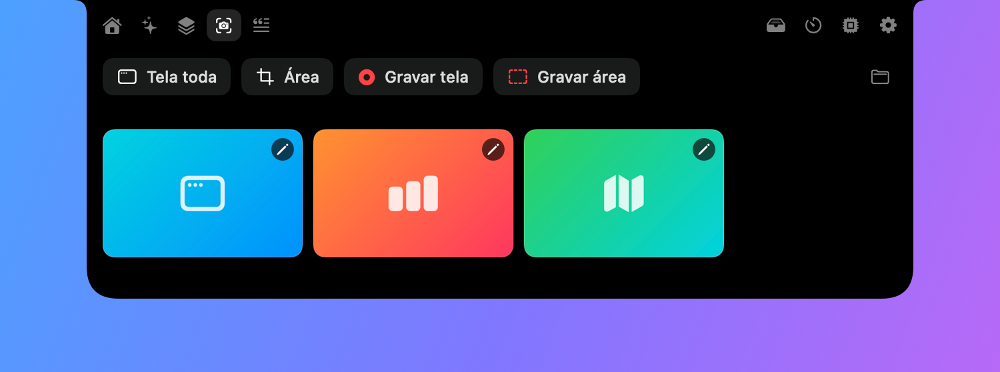

- Print da tela toda ou de uma área.
- Gravação da tela toda ou de uma área.
- Os prints e gravações feitos pelos atalhos do macOS (⇧⌘3, ⇧⌘4, ⇧⌘5) também aparecem aqui.
- Galeria com as últimas capturas: um clique copia, clique com dois dedos abre no app padrão.
- Anotar um print: seta, retângulo, texto e borrar. O resultado é salvo como cópia e já vai copiado.
- O notch não aparece nas capturas.

### Textos

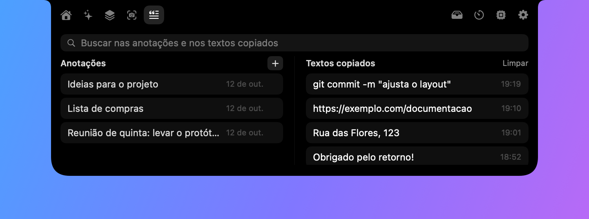

- Anotações: crie quantas quiser; são salvas automaticamente.
- Histórico de textos copiados: clique para copiar de novo, ou salve um item como anotação. Senhas copiadas de gerenciadores ficam de fora.
- Busca única nas anotações e nos textos copiados.

### Arquivos

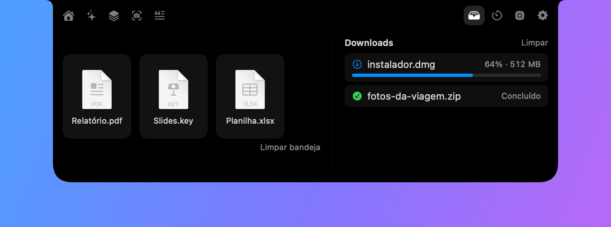

- Bandeja: solte arquivos no notch para guardá-los e arraste para outro lugar depois.
- Downloads: progresso dos arquivos baixando na pasta Downloads (Safari, Chrome, Brave e outros apps que informam o progresso ao sistema). Com o notch fechado, a porcentagem aparece ao lado dele.

### Timers

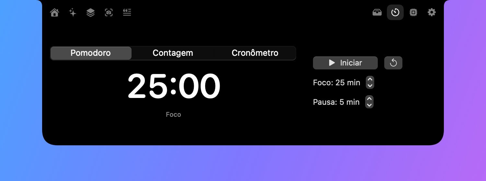

Pomodoro (foco e pausa), contagem regressiva e cronômetro. Com o notch fechado, o tempo aparece ao lado dele.

### Sistema

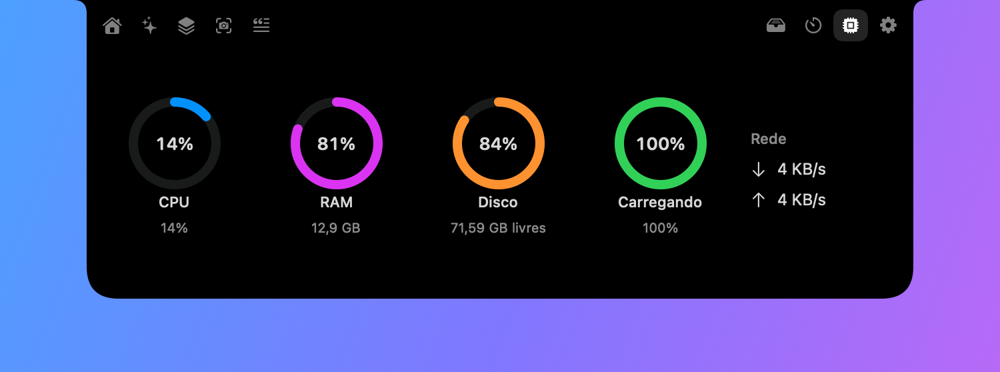

CPU, memória, disco, bateria e velocidade da rede.

### Volume e brilho

Ao mudar o volume ou o brilho, um indicador aparece ao lado do notch.

### Atalhos de teclado

| Atalho | Ação |
|---|---|
| ⌃⌥N | Abrir ou fechar o notch |
| ⌃⌥V | Abrir Textos |
| ⌃⌥S | Abrir Captura de tela |
| ⌃⌥R | Gravar uma área / parar a gravação |

### Vários monitores

O painel aparece em todos os monitores conectados, cada um com o seu estado aberto ou fechado. Dá para deixar só na tela do MacBook.

### Configurações

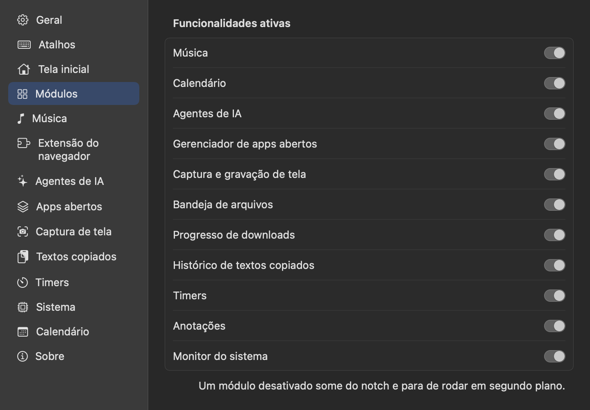

Abertas pela engrenagem dentro do notch ou pelo ícone da barra de menus. Cada módulo pode ser ligado ou desligado, e quase tudo é ajustável: como o notch abre, tempos de espera, quais ferramentas de IA acompanhar, pasta das capturas, tamanho do histórico, blocos da tela inicial e assim por diante.

Também há:

- Tela de boas-vindas, que explica cada permissão e deixa liberar na hora.
- Idioma: igual ao do sistema, português ou inglês.
- Exportar e importar as configurações em um arquivo.
- Aviso de versão nova, com link para a página de download.

## Como compilar

Requisitos: macOS 14 ou mais recente e Xcode (ou as Command Line Tools) com Swift 5.9+.

```bash
./build.sh && open build/OpenNotch.app
```

O script compila em modo release e monta `build/OpenNotch.app`. Se houver um certificado "Apple Development" no Keychain, o app é assinado com ele; assim o macOS mantém as permissões entre uma compilação e outra. Sem certificado, a assinatura é ad hoc e as permissões são pedidas de novo a cada compilação.

Para publicar uma versão, atualize o arquivo `VERSION` e envie uma tag (`git tag v0.2.0 && git push origin v0.2.0`). O GitHub Actions compila, empacota e cria a release com o `OpenNotch.zip`.

Para uma versão notarizada (que abre em qualquer Mac sem aviso), é preciso uma conta paga do Apple Developer Program; o passo a passo está em `Scripts/notarize.sh`.

As imagens deste README são geradas pelo próprio app, em modo de demonstração e com dados fictícios, sem capturar a tela:

```bash
./Scripts/make-screenshots.sh
```

Para regenerar o ícone:

```bash
./Scripts/make-icon.sh
```

## Permissões

O macOS pede cada uma na primeira vez que o recurso é usado:

| Permissão | Para quê |
|---|---|
| Automação (Spotify, Music) | Controlar a reprodução e ler a capa |
| Gravação de Tela | Prints e gravações |
| Calendários | Mostrar os eventos de hoje |
| Arquivos da Mesa | Ler os prints feitos pelos atalhos do macOS |
| Pasta Downloads | Mostrar o progresso dos downloads |

## Privacidade

- Nada é enviado para servidores do OpenNotch; ele não tem servidores.
- O histórico de textos copiados e as anotações ficam só neste Mac, em `~/Library/Application Support/OpenNotch`.
- A extensão do navegador conversa apenas com o app, em `127.0.0.1`.
- Para buscar a capa de uma música quando a Automação não está liberada, o app consulta os serviços públicos do Spotify (pelo id da faixa) e do iTunes (por título e artista).

## Limitações conhecidas

- A capa é sempre estática: as capas animadas do Spotify (Canvas) e do Apple Music não são expostas aos outros apps.
- O uso do limite do plano do Claude não é mostrado, porque não fica em nenhum arquivo local.
- A detecção do Antigravity é aproximada e pode avisar "terminou" numa pausa longa do agente.
- O indicador de volume e brilho aparece junto com o aviso padrão do macOS, sem substituí-lo.
- Widgets do macOS não podem ser embutidos; os blocos da tela inicial são do próprio app.
- A extensão do navegador ainda não suporta Safari nem Firefox, e é instalada manualmente.
- O app ainda não é notarizado; por isso o macOS pede a liberação manual na primeira abertura.
- A atualização não é automática: o app avisa e a instalação é manual.
- A gravação de tela pega só o monitor principal.

## Estrutura do projeto

```
Sources/OpenNotch/
  main.swift, AppDelegate.swift     ponto de entrada e ícone da barra de menus
  NotchController.swift             janela sobre o notch e ligação entre os módulos
  NotchModel.swift                  estado aberto/fechado e abas
  NotchRootView.swift               interface do notch aberto e fechado
  Prefs.swift, SettingsWindow.swift preferências e janela de configurações
  HotKeys.swift                     atalhos de teclado globais
  BrowserBridge.swift               servidor local que recebe a música do navegador
  Updater.swift, Onboarding.swift   aviso de versão nova e tela de boas-vindas
  Localization.swift                função de tradução (as frases em inglês ficam em Resources/en.lproj)
  ProcScan.swift, RegionSelector.swift
  Modules/                          um arquivo por funcionalidade
Extension/                          extensão do navegador
Scripts/                            ícone, imagens do README e notarização
docs/screenshots/                   imagens do README
```

## Licença

O OpenNotch é distribuído sob a [PolyForm Noncommercial License 1.0.0](LICENSE.md).

Em resumo: você pode usar, estudar, modificar e redistribuir o app e o código livremente, desde que **não seja para fins comerciais**. Não é permitido vender o app, cobrar pelo acesso a ele nem usá-lo para obter lucro. O texto da licença é o que vale; este resumo não o substitui.
